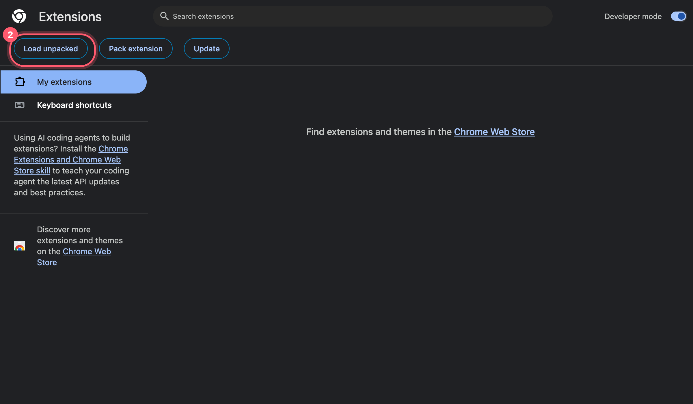
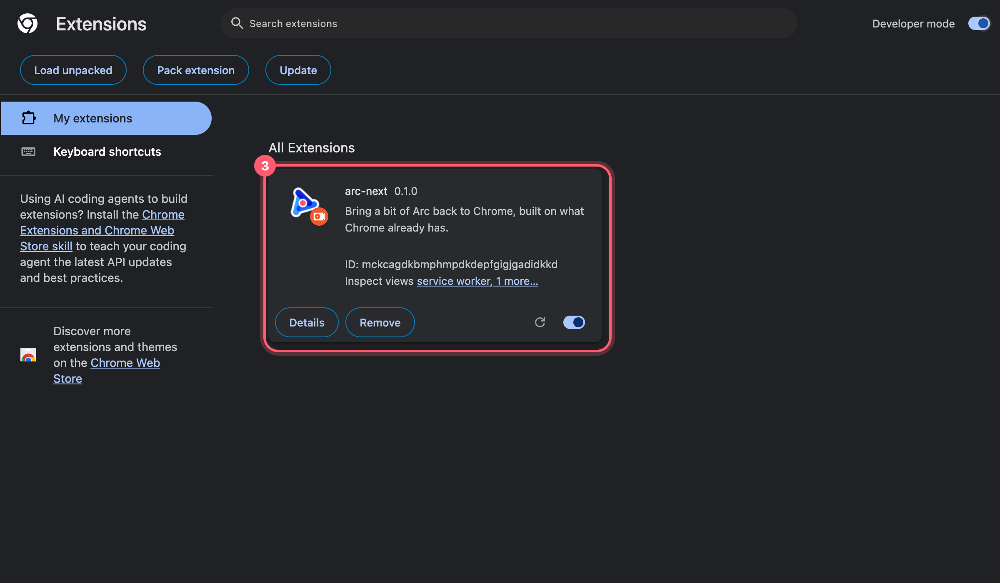
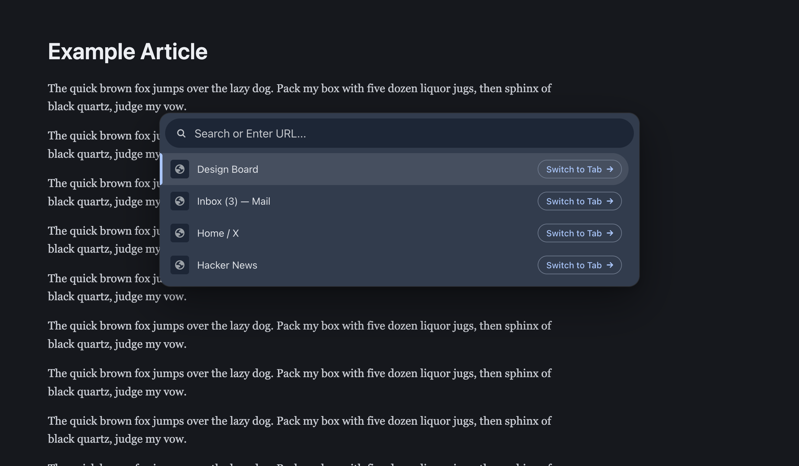

<p align="center">
  
</p>

<h1 align="center">arc-next</h1>

<p align="center">
  <a href="https://chromewebstore.google.com/detail/arc-next/pdjfhfbahgalbcpabpghbhobacmimjbk"></a>
  
  
  
</p>

I've been using Arc since its invite-only beta in 2021. Browsers had been boring for years, and I still remember how different Arc felt the first time I opened it.

I get why The Browser Company moved on to Dia. It makes sense as a business. I still can't quite let go, mostly because nothing else has felt that new since.

Last month the email came saying Arc was being discontinued, so I went looking for a replacement. Zen is great, but I can't live without my Chrome extensions, so Chromium it is. Chrome has changed a lot since I left, and that gave me the idea: use what Chrome already has, and bring a bit of Arc over.

I read every Arc release page and tried every new feature, but only a few stuck. The sidebar is one. A lot of Arc-inspired extensions draw their own, and it never feels right and tends to fight with other extensions. arc-next doesn't bother; it uses Chrome's native vertical tabs.

Favorites are what I use most. I open Twitter and Hacker News all day long. Chrome's pinned tabs get most of the way there, with two gaps: you can't reset one, and pressing ⌘W twice closes it for good. arc-next fixes both, so a Favorite only goes away when you unpin it yourself.

A Space's Pinned area maps onto Chrome's tab groups, which have the same gaps as pinned tabs. So they get the same reset and close protection, plus a shortcut to add the current page to the Space. Everything else is Today, which cleans itself up after 12 hours, or right away if you ask. A cleanup closes the idle pages in Today and resets Pinned and Favorites.

Then ⌘T. I live in a launcher (die-hard Raycast user here), so this one matters a lot to me. I tried Arc Search and a few extensions, and none of them searched the right things or ranked them well. So I ported the data sources and ranking algorithm from Chrome's address bar and added some of Arc's design on top. It's now a launcher I can actually live with.

Of the features I really care about, the only one missing is Arc's profile switching. I looked into doing it from an extension, and every approach I found was a hack: fragile, a lot of work, and full of per-site cookie quirks. So it's not supported for now. I'll come back to it when Chrome's APIs allow more.

Going back to Chrome isn't so bad. Cross-platform works better again, and extensions support Chrome first. But I'm still sad to see Arc go. If you miss Arc too, I hope this helps a little.

## Getting started

### 1. Move the tab strip to the side

Chrome shows tabs in a row across the top of the window by default. Start by moving them into a column on the left:

1. Right-click the tab strip at the top of the window. An empty area or any tab will do.
2. Choose **Show Tabs Vertically** from the menu.

The tabs move to the left side of the window right away, stacked in a column. This is your sidebar; arc-next does not draw another one.

Two related actions live in the same right-click menu:

- **Collapse Tabs** shrinks the column to a narrow strip of icons. **Expand Tabs** brings it back.
- **Show Tabs Horizontally** returns the tabs to the top.

For Arc's ⌘S toggle: in macOS **System Settings → Keyboard → Keyboard Shortcuts → App Shortcuts**, add **Collapse Tabs** and **Expand Tabs** for Google Chrome, both ⌘S, named exactly as Chrome's menu shows them. This takes ⌘S away from Save Page As.

### 2. Install the extension

Install it from the [Chrome Web Store](https://chromewebstore.google.com/detail/arc-next/pdjfhfbahgalbcpabpghbhobacmimjbk). Chrome keeps it up to date.

<details>
<summary>Or load it by hand from GitHub</summary>

1. Download `arc-next.zip` from the [latest release](https://github.com/TalkWIthKeyboard/arc-next/releases/latest) and unzip it. You get a folder named `arc-next`; remember where it is. If you use git, you can clone instead:

   ```sh
   git clone https://github.com/TalkWIthKeyboard/arc-next.git
   ```

2. Type `chrome://extensions` in Chrome's address bar and press Enter to open the Extensions page.
3. Turn on **Developer mode** in the top right corner.

   

4. A row of buttons appears in the top left. Click **Load unpacked**.

   

5. In the file picker, select the `arc-next` folder (the one that directly contains `manifest.json`) and confirm.
6. The arc-next card appears in the list. The extension is installed.

   

</details>

### 3. Set the shortcuts

Chrome does not let an extension claim ⌘T and ⌘D on its own, so you set them once by hand.

1. Click **Keyboard shortcuts** on the left of the Extensions page, or type `chrome://extensions/shortcuts` in the address bar.
2. Find the arc-next section.
3. Click the pencil icon next to **Open Command Bar**, then press ⌘T.
4. Click the pencil icon next to **Pin/Unpin Tab in Space**, then press ⌘D.


All the commands are listed below. The last three can stay as they are, or be set later:

| Command                       | Suggested key       | What it does                                                   |
| ----------------------------- | ------------------- | -------------------------------------------------------------- |
| Open Command Bar              | ⌘T                  | Opens the search overlay                                       |
| Pin/Unpin Tab in Space        | ⌘D                  | Adds the current page to the Space; press again to take it out |
| Reset Tab                     | ⌃R (set by default) | Resets the current tab                                         |
| Open Peek as a Tab            | ⌘O                  | Keeps the page in a peek window as a normal tab                |
| Clear Today                   | Your choice         | Cleans up the current window right now                         |
| Replace Pin with Current Page | Your choice         | Makes the current page this tab's new pinned URL               |

### 4. Bring your Arc sidebar over (optional)

The welcome page that opens after installing has an import step. To open it again later, click **Details** on the arc-next card and then **Extension options**.

1. On the import step, click the box, press ⌘⇧G in the file picker, and paste this path:

   ```
   ~/Library/Application Support/Arc/StorableSidebar.json
   ```

   On Windows, or if that file is gone, open Arc's Settings → Advanced → **Export Data** and use `Arc Data Export.md` instead. That file is coarser: its Favorites section also contains the pinned and Today tabs that were not in a folder.

2. Tick the Spaces that belong in this Chrome profile. Arc Spaces are tied to profiles, so import each Space in the Chrome profile it belongs to.
3. Check where each part goes, then click **Import**.

| In Arc                  | In Chrome                                      |
| ----------------------- | ---------------------------------------------- |
| Favorites               | Pinned tabs                                    |
| Pinned tabs in a Space  | A group named `🧲 Life`                        |
| A folder, nested or not | Its own group, such as `🧲 Life/Study/English` |
| Today tabs              | Skipped unless you choose otherwise            |

Imported tabs load once so they get a title and an icon, then go to sleep until you click them. Importing the same file twice does not open anything twice. Split views come over as separate tabs; Easels, notes and Boosts do not come over.

### 5. Pin a page and try Favorites

1. Open a site you visit every day.
2. Right-click its tab in the sidebar and choose **Pin**. The tab shrinks to an icon and moves to the top of the sidebar.
3. Click around in the page until you are somewhere else, then press ⌃R. It returns to the URL it had when you pinned it.
4. Click a link to another site. It opens in a floating window over the pinned page, like Arc's Peek. Click back on the main window and it goes away; press ⌘O in it to keep it as a normal tab.
5. Press ⌘W. The tab is not closed; it returns to its pinned URL.

To really remove it, right-click the tab and choose **Unpin**.

### 6. Create your first Space

1. Open a page and press ⌘D. A tab group named `🧲 Space` appears at the top of the sidebar, with this page already in it.
2. Open another page and press ⌘D. It joins the same group. You can also drag tabs in.
3. Pages in the group are as steady as pinned ones: ⌃R resets them, ⌘W does not close them, and links to other sites open outside the group.
4. Press ⌘D again on a page in the group to take it out.

To rename the group, click its title. Call it anything you like, as long as the name still starts with 🧲. Ordinary tabs outside the group are Arc's Today area.

### 7. Find things with ⌘T

Press ⌘T on any page and a search box appears in the middle of the screen. Before you type, it lists your other open pages:



Type a few letters:

- Pages that are already open show **Switch to Tab**. Press Enter to jump there.
- Bookmarks and history are in the results too, with the pages you visit most at the top.
- When nothing matches, Enter searches the web. Type a URL to open it directly.
- Use ↑ and ↓ to choose, and Esc to close.


## Good to know

- **Today tabs left idle for more than 12 hours are closed automatically**, while pinned pages and pages in a Space are reset instead. Closed pages stay in your history, so ⌘⇧T or a ⌘T search brings them back. To change the time or turn it off, click the arc-next icon in the toolbar.
- **The search overlay does not appear on the new tab page or on `chrome://` pages.** Chrome does not allow extensions to show content there, so ⌘T opens a native new tab instead.
- **For Arc's mini player, turn on Chrome's own.** Open `chrome://settings/content/autoPictureInPicture` and choose **Sites can enter picture-in-picture automatically**. A video that is playing with sound then moves into a small window when you switch tabs and goes back when you return. Chrome keeps one mini player at a time, only on `https` pages, and decides where the window sits.
- **⌘D is Chrome's "Bookmark this tab" by default.** Once it belongs to arc-next, use the star in the address bar to add bookmarks.
- **The overlay's colors do not follow your Chrome theme automatically.** An extension cannot read the browser's theme color. The colors are derived from one value, `--seed`, at the top of `palette.html`; change it when you change your theme.
- All data is read locally. The extension makes no network requests.

## License

MIT. The search ranking is ported from Chromium (BSD-3-Clause); see [LICENSE](LICENSE).
