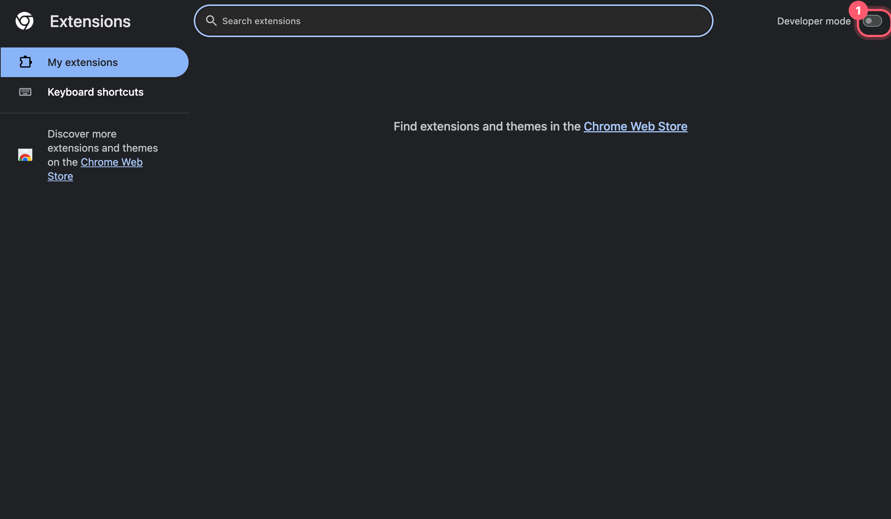
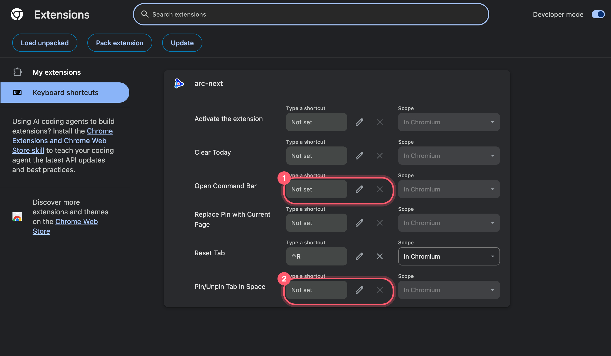
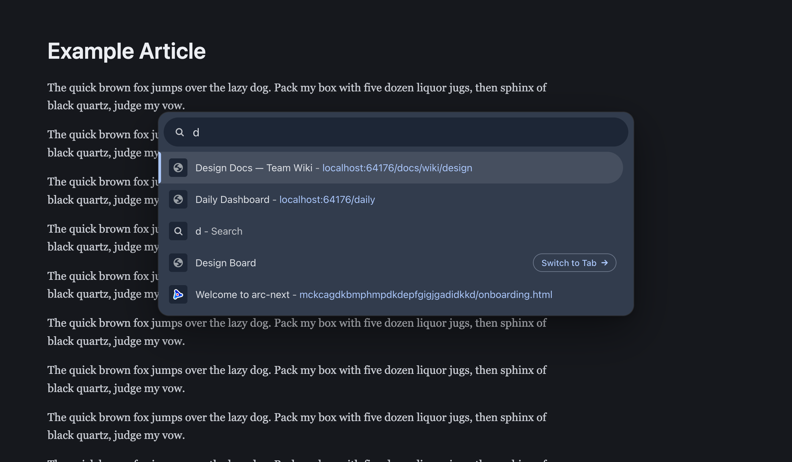

<p align="center">
  
</p>

<h1 align="center">arc-next</h1>

<p align="center">
  
  
  
</p>

I have been using Arc since its invite-only beta in 2021. Browsers had been boring for years, and I still remember how striking Arc felt the first time I used it. As a business decision, I completely understand why The Browser Company moved on from Arc to build Dia. Personally, I find it hard to let go, especially of the sense of novelty it gave me. Last month I received the email saying Arc was being discontinued, so I started looking for a replacement. Zen Browser is excellent, but the Chrome extensions I depend on keep me on Chromium. Coming back to Chrome after a long time away, I found it had changed as well, so I decided to make full use of what Chrome already offers and bring a bit of Arc to it.

Over the years, every Arc release page was a delight, and I tried every new feature. In the end only a few became part of my daily routine. The first is the sidebar. Many Arc-inspired extensions build a sidebar of their own, but honestly the experience is not great and it tends to conflict with other extensions. So arc-next keeps things simple and uses Chrome's native vertical tabs.

Favorites in the sidebar are what I use most. I open Twitter and Hacker News countless times a day. Chrome's pinned tabs cover part of this, with a few subtle differences: a pinned tab cannot be reset, and pressing ⌘W twice closes the pinned page for good. arc-next adds a small fix so that a Favorite can only be removed by unpinning it yourself.

The Pinned area of a Space can be built on Chrome's tab groups, which have the same problems as pinned tabs. They get the same reset and close protection, plus a shortcut for quickly adding a page to the Space. The Today area gets automatic cleanup after 12 hours and a manual clear. A cleanup closes the inactive pages in Today and also resets Pinned and Favorites.

Then there is ⌘T search. I am used to a quick launcher (and a die-hard Raycast user), so this one matters a lot to me. I tried Arc Search and other extensions and found that both their ranking and what they search had problems of one kind or another, which made them painful to use. So I ported the data sources and the ranking algorithm of Chrome's address bar and added some of Arc's design. It now feels like a passable launcher.

Last is Arc's seamless multi-profile switching. I looked into reproducing it with an extension. At first glance the existing approaches are all rather hacky, with no guarantee on effort or stability, and they need separate handling for the cookie behavior of many sites. So it is not supported for now. I will revisit it when Chrome offers more flexible APIs.

Going back to Chrome is not a bad thing. I get a better cross-platform experience again, and extensions support it first. But I am still sad to see Arc go, and I hope this extension brings a little comfort to others who feel the same.

## Getting started

### 1. Move the tab strip to the side

Chrome shows tabs in a row across the top of the window by default. Start by moving them into a column on the left:

1. Right-click the tab strip at the top of the window. An empty area or any tab will do.
2. Choose **Show Tabs Vertically** from the menu.

The tabs move to the left side of the window right away, stacked in a column. This is your sidebar; arc-next does not draw another one.

Two related actions live in the same right-click menu:

- **Collapse Tabs** shrinks the column to a narrow strip of icons. **Expand Tabs** brings it back.
- **Show Tabs Horizontally** returns the tabs to the top.

### 2. Install the extension

1. [Download the ZIP](https://github.com/TalkWIthKeyboard/arc-next/archive/refs/heads/main.zip) and unzip it. You get a folder named `arc-next-main`; remember where it is. If you use git, you can clone instead:

   ```sh
   git clone https://github.com/TalkWIthKeyboard/arc-next.git
   ```

2. Type `chrome://extensions` in Chrome's address bar and press Enter to open the Extensions page.
3. Turn on **Developer mode** in the top right corner.

   

4. A row of buttons appears in the top left. Click **Load unpacked**.

   

5. In the file picker, select that folder (`arc-next-main`, or `arc-next` if you cloned; it is the one that directly contains `manifest.json`) and confirm.
6. The arc-next card appears in the list. The extension is installed.

   

### 3. Set the shortcuts

Chrome does not let an extension claim ⌘T and ⌘D on its own, so you set them once by hand.

1. Click **Keyboard shortcuts** on the left of the Extensions page, or type `chrome://extensions/shortcuts` in the address bar.
2. Find the arc-next section.
3. Click the pencil icon next to **Open Command Bar**, then press ⌘T.
4. Click the pencil icon next to **Pin/Unpin Tab in Space**, then press ⌘D.



All the commands are listed below. The last three can stay as they are, or be set later:

| Command                       | Suggested key       | What it does                                                   |
| ----------------------------- | ------------------- | -------------------------------------------------------------- |
| Open Command Bar              | ⌘T                  | Opens the search overlay                                       |
| Pin/Unpin Tab in Space        | ⌘D                  | Adds the current page to the Space; press again to take it out |
| Reset Tab                     | ⌃R (set by default) | Resets the current tab                                         |
| Clear Today                   | Your choice         | Cleans up the current window right now                         |
| Replace Pin with Current Page | Your choice         | Makes the current page this tab's new pinned URL               |

### 4. Pin a page and try Favorites

1. Open a site you visit every day.
2. Right-click its tab in the sidebar and choose **Pin**. The tab shrinks to an icon and moves to the top of the sidebar.
3. Click around in the page until you are somewhere else, then press ⌃R. It returns to the URL it had when you pinned it.
4. Click a link to another site. The new page opens in a new tab and the pinned page stays where it is.
5. Press ⌘W. The tab is not closed; it returns to its pinned URL.

To really remove it, right-click the tab and choose **Unpin**.

### 5. Create your first Space

1. Open a page and press ⌘D. A tab group named `🧲 Space` appears at the top of the sidebar, with this page already in it.
2. Open another page and press ⌘D. It joins the same group. You can also drag tabs in.
3. Pages in the group are as steady as pinned ones: ⌃R resets them, ⌘W does not close them, and links to other sites open outside the group.
4. Press ⌘D again on a page in the group to take it out.

To rename the group, click its title. Call it anything you like, as long as the name still starts with 🧲. Ordinary tabs outside the group are Arc's Today area.

### 6. Find things with ⌘T

Press ⌘T on any page and a search box appears in the middle of the screen. Before you type, it lists your other open pages:


Type a few letters:

- Pages that are already open show **Switch to Tab**. Press Enter to jump there.
- Bookmarks and history are in the results too, with the pages you visit most at the top.
- When nothing matches, Enter searches the web. Type a URL to open it directly.
- Use ↑ and ↓ to choose, and Esc to close.



## Good to know

- **Today tabs left idle for more than 12 hours are closed automatically**, while pinned pages and pages in a Space are reset instead. Closed pages stay in your history, so ⌘⇧T or a ⌘T search brings them back. To turn automatic cleanup off, set `ARCHIVE_AFTER_HOURS` in `background.js` to 0.
- **The search overlay does not appear on the new tab page or on `chrome://` pages.** Chrome does not allow extensions to show content there, so ⌘T opens a native new tab instead.
- **⌘D is Chrome's "Bookmark this tab" by default.** Once it belongs to arc-next, use the star in the address bar to add bookmarks.
- **The overlay's colors do not follow your Chrome theme automatically.** An extension cannot read the browser's theme color. The colors are derived from one value, `--seed`, at the top of `palette.html`; change it when you change your theme.
- All data is read locally. The extension makes no network requests.

## License

MIT. The search ranking is ported from Chromium (BSD-3-Clause); see [LICENSE](LICENSE).
